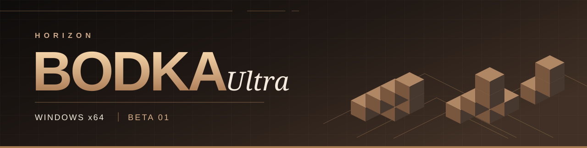
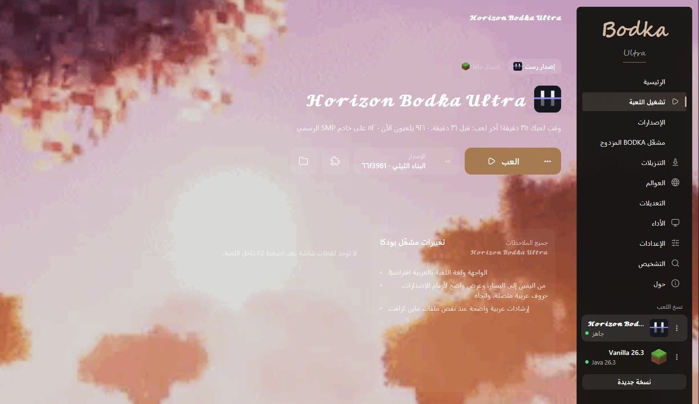

# 𝓗𝓸𝓻𝓲𝔃𝓸𝓷 𝓑𝓸𝓭𝓴𝓪 𝓤𝓵𝓽𝓻𝓪

مشغّل عربي يجمع تثبيتات **Minecraft: Java Edition** المحلية من المشغّل الرسمي و**TLauncher** في مكتبة واحدة. تصفّح الإصدارات والمودات، واستورد النسخة التي تختارها، ثم شغّلها من واجهة BODKA.

<strong>Beta 0.2.0-beta.1</strong> · Windows 10 / 11 · x64 · 107.5 MiB

<a href="https://github.com/aboodksa4011/Horizon-Bodka-Ultra-Beta/releases/tag/v0.2.0-beta.1">تفاصيل الإصدار</a> · <a href="https://github.com/aboodksa4011/Horizon-Bodka-Ultra-Beta/releases">جميع الإصدارات</a> · <a href="https://github.com/aboodksa4011/Horizon-Bodka-Ultra-Beta/releases/download/v0.2.0-beta.1/SHA256SUMS.txt">بصمة ملف ويندوز</a>

## أول تشغيل على ويندوز

1. [نزّل **HorizonBodkaUltra.exe**](https://github.com/aboodksa4011/Horizon-Bodka-Ultra-Beta/releases/download/v0.2.0-beta.1/HorizonBodkaUltra.exe) وضعه في مجلد تحتفظ به. هذا هو ملف المشغّل الجاهز للتشغيل.
2. افتح الملف. تظهر الافتتاحية عند الدخول الأول، ثم اضغط **موافق** للدخول إلى واجهة الضيف.
3. اختر **مشغّل BODKA المزدوج** من القائمة الجانبية. تظهر الإصدارات المكتشفة أثناء فحص الأقراص. لتحديد التثبيت يدويًا، اضغط **اختيار مجلد اللعبة** وحدد المجلد الذي يحتوي على `versions`.
4. افتح قائمة المودات في بطاقة الإصدار وراجع المصدر والمجلد. يضيف **استيراد النسخة** نسخة مستقلة إلى BODKA. يجمع **استيراد وتشغيل** الخطوتين ويطبق التحقق المعتاد من ملكية Java Edition.

## ما الذي تقدمه النسخة التجريبية؟

| داخل التطبيق | ما يمكنك فعله |
| --- | --- |
| المشغّل المزدوج | فرز التثبيتات حسب المصدر، والتعرف على مجلدات المودات المنفصلة، والرجوع إلى النسخ المستوردة. |
| إصلاح ملفات اللعبة | التحقق من البصمات، وإعادة استخدام الملفات السليمة، واستعادة ملفات اللعبة المطلوبة من المصادر المعتمدة. يُستعاد المود المفقود من مصدره المحلي إذا طابق بصمته وقت الاستيراد. |
| التنزيلات | متابعة تقدم تنزيل إصدارات Horizon والتحقق منها، وإيقاف النقل واستكماله عندما يدعمه المصدر. |
| التخصيص | تغيير الثيم والخلفية ومستوى الحركة وأصوات الواجهة. يحفظ المشغّل اختياراتك ويدعم العرض من اليمين إلى اليسار. |

**حساب Minecraft.** يتيح وضع الضيف التصفح والاستيراد المحلي. يتطلب اللعب بالنسخة الرسمية حساب Microsoft يملك Java Edition. يحتاج تسجيل الدخول في هذا البناء المخصص إلى معرّف تطبيق Microsoft مسجّل في `HORIZON_MSA_CLIENT_ID`. ملفات Minecraft التجارية تُجلب عند استيفاء متطلبات الملكية.

**حالة Beta.** الإصدار المنشور هو بناء التطوير المختبر لويندوز x64. ملف EXE غير موقّع بتوقيع Windows Authenticode. نجح 747 اختبارًا تلقائيًا، واختُبر استيراد الإصدار 26.3 من تثبيت رسمي. استُخدمت تثبيتات اختبار للتحقق من دعم TLauncher. لم يُختبر تشغيل جلسة لعب مدفوعة أو التثبيت على جهاز ويندوز نظيف. [دليل ويندوز](docs/BODKA-RELEASE.md) · [تقرير التحقق](BODKA-11-IMPLEMENTATION-REPORT.md)

## المصدر والترخيص

هذه نسخة مستقلة مبنية على Horizon. يحتفظ المستودع بتاريخ المشروع الأصلي وأسماء مساهميه. [مشروع Horizon](https://github.com/horizon-rust/horizon) · [دليل Horizon الأصلي](README-Horizon.md) · [الرخصة](LICENSE) · [إشعارات الطرف الثالث](THIRD_PARTY_NOTICES.md)
