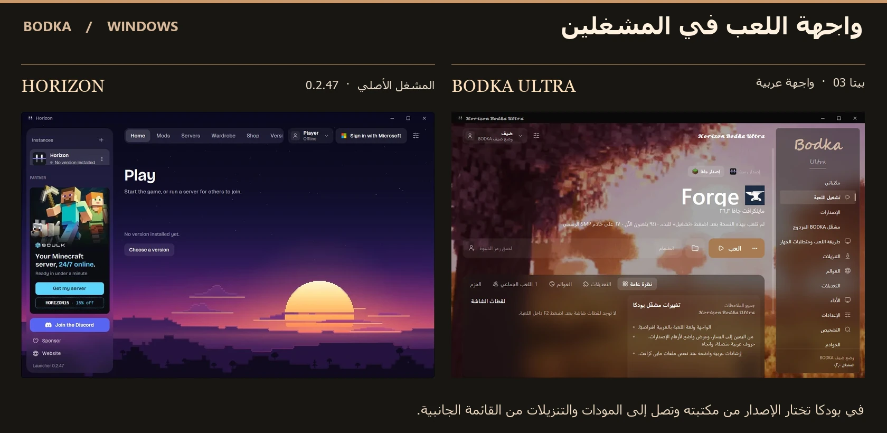
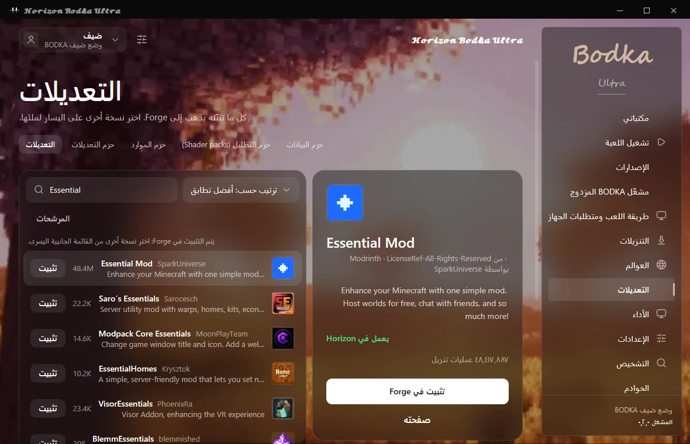

# 𝓗𝓸𝓻𝓲𝔃𝓸𝓷 𝓑𝓸𝓭𝓴𝓪 𝓤𝓵𝓽𝓻𝓪

**Beta 03 · Minecraft Java Edition · Windows x64**

مشغّل ماينكرافت بالعربية. خصّص مكتبة لكل إصدار ومحمّل، ثم أضف المودات المتوافقة وشغّل اللعبة من بطاقتها.

[تفاصيل الإصدار](https://github.com/aboodksa4011/Horizon-Bodka-Ultra-Beta/releases/tag/v0.2.0-beta.3) · [دليل ويندوز](docs/BODKA-RELEASE.md) · [معرض الواجهات والقوائم](docs/BODKA-GALLERY.md)

## كيف تلعب؟

| اختيارك | الخطوات داخل BODKA | الحساب |
| --- | --- | --- |
| Minecraft Java الرسمية | اختر **عندي ماينكرافت الأصلية** واربط حسابك. حدّد الإصدار من قائمة Mojang واضغط **العب** من مكتبته. | حساب Microsoft يملك Minecraft Java Edition. |
| نسخة محلية أو مكركة عبر TLauncher | اختر **عندي نسخة محلية أو مكركة** ثم **فحص TLauncher**. بعد اكتشاف التطبيق اضغط **فتح TLauncher** وأكمل اللعب فيه. | فتح TLauncher من BODKA متاح دون حساب Microsoft ودون امتلاك النسخة الرسمية. |
| تصفّح كضيف | افتح المكتبة، تصفّح المحتوى وعدّل إعدادات الواجهة. | متاح مباشرة. |

إذا لم يظهر TLauncher، تتيح صفحة الفحص فتح موقعه وإعادة الفحص بعد تثبيته. لاستيراد إصدار محلي، حدّد مجلد اللعبة الذي يحتوي على `versions`. زر تشغيل النسخة المستوردة **داخل BODKA** يستخدم مسار Java الرسمي.

## داخل Beta 03

- **Java بإصدار محدّد.** يظهر رقم الإصدار في صفحة اللعب ونافذة الربط. يحتفظ طلب التشغيل بالمكتبة والعالم أو الخادم المحدد أثناء تسجيل الدخول. أُزيل خيار لعبة المتصفح Minecraft Classic.
- **مكتبات ومودات.** اختر Vanilla أو Fabric أو Forge أو NeoForge أو Quilt، أو أنشئ مكتبة مستقلة لمحرك Horizon Rust. يدعم الكتالوج البحث حسب الإصدار والمحمّل، وإضافة ملفات محلية، وتعطيل مود ونسخ رمز المكتبة للمشاركة.
- **عوالم وتنزيلات وأدوات.** اعرض حالة التجهيز، وأدر العوالم والخوادم، وافتح التشخيص وقياسات واجهة المشغّل. يمكن تعديل الثيم والخلفية والحركة والصوت من الإعدادات.

## التثبيت والتحقق

فك ضغط الحزمة كاملة، وافتح `HorizonBodkaUltra.exe` وأبقِ مجلد `Horizon` بجانبه. نجح 758 اختبارًا آليًا للمشغّل. جرى اختبار استيراد إصدار Java 26.3 محليًا والتحقق من ملفه بمطابقة بصمة Mojang. [بصمات التنزيل](https://github.com/aboodksa4011/Horizon-Bodka-Ultra-Beta/releases/download/v0.2.0-beta.3/SHA256SUMS.txt) · [تقرير التنفيذ والاختبارات](BODKA-11-IMPLEMENTATION-REPORT.md)

[مشروع Horizon الأصلي](https://github.com/horizon-rust/horizon) · [دليل Horizon](README-Horizon.md) · [الترخيص](LICENSE) · [إشعارات الطرف الثالث](THIRD_PARTY_NOTICES.md)
