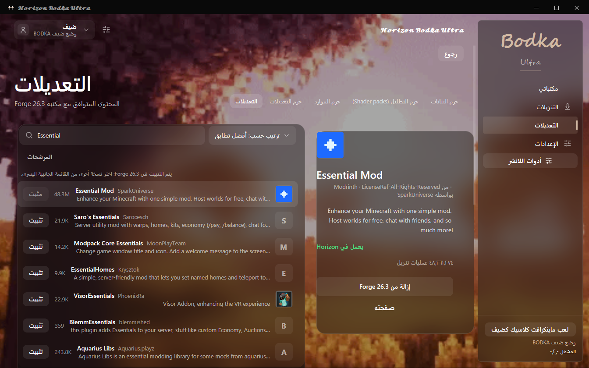
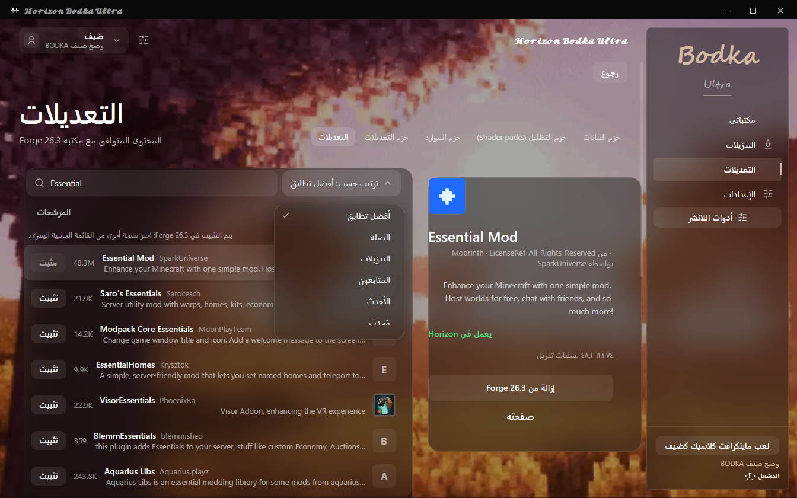

# 𝓗𝓸𝓻𝓲𝔃𝓸𝓷 𝓑𝓸𝓭𝓴𝓪 𝓤𝓵𝓽𝓻𝓪

مشغّل عربي لماينكرافت على ويندوز. أنشئ مكتبة لكل إصدار تلعبه، واختر محمّل المودات، ثم أضف المودات المتوافقة من داخل المكتبة. ويمكنك استيراد تثبيت محلي من المشغّل الرسمي أو TLauncher عبر **مشغّل BODKA المزدوج**.

<strong>Beta 02</strong> · Windows 10 / 11 · x64 · ZIP · 50.5 MiB

<a href="https://github.com/aboodksa4011/Horizon-Bodka-Ultra-Beta/releases/tag/v0.2.0-beta.2">تفاصيل الإصدار</a> · <a href="docs/BODKA-RELEASE.md">دليل التشغيل والتحديث</a> · <a href="https://github.com/aboodksa4011/Horizon-Bodka-Ultra-Beta/releases/download/v0.2.0-beta.2/SHA256SUMS.txt">بصمات الملفات</a>

## داخل Beta 02

تظهر ألوان خلفية الغروب من خلال قائمة المودات وبطاقة التفاصيل. يتبع التمويه حركة الخلفية، وتبقى الكتابة والأيقونات حادّة. عند فتح مود أو الرجوع إلى المكتبة، تتلاشى الصفحة في مكانها وتبقى الأزرار ثابتة تحت المؤشر.

شاهد قائمة الفرز مفتوحة داخل التطبيق

## من أول تشغيل إلى أول مود

1. حمّل حزمة ويندوز أعلاه، وفكّ ضغطها بالكامل، ثم افتح `HorizonBodkaUltra.exe`. عند أول تشغيل اضغط **موافق** بعد انتهاء الافتتاحية.
2. اختر **إنشاء مكتبة**، وسمّها وحدّد إصدار اللعبة والمحمّل. تقدر مثلًا تخصص مكتبة لـ Fabric وأخرى لـ Forge، وتتابع التجهيز من بطاقة كل مكتبة.
3. افتح **تعديل ← التعديلات** في بطاقة المكتبة. ابحث عن المود واضغط **تثبيت**، أو الصق ملف مود محليًا. تقدر تواصل التصفح أثناء التنزيل.
4. من صفحة المكتبة تقدر تفعّل المودات أو تعطّلها، وتستورد عالمًا من ملف ZIP، أو تنسخ رمز المكتبة لصديق يستعيد إصدارات المودات المنشورة من مصادرها.

يدخل المستخدم كضيف لتصفح المكتبات وإدارتها. لتجربة اللعبة كضيف اختر **لعب ماينكرافت كلاسيك كضيف**. لتشغيل إصدار Java الحديث، اختر **ربط Microsoft عبر هورايزن** وسجّل بحساب يملك اللعبة. تتضمن حزمة ZIP مساعد Horizon المستخدم في الربط.

## التوافق والاختبارات

يتحدد كتالوج المكتبة حسب إصدار Minecraft والمحمّل المختارين. يدعم مسار Java مكتبات Fabric وForge وNeoForge وQuilt، ولمحرك Horizon Rust إصداراته وحزمه الخاصة. نجح 754 اختبارًا آليًا للمشغّل، واختُبرت على ويندوز أيضًا شاشة الكتالوج وقائمة الفرز والرجوع وتمرير الإعدادات. [تقرير الاختبارات وحدود التوافق](BODKA-11-IMPLEMENTATION-REPORT.md)

## المصدر والترخيص

تحتفظ هذه النسخة بتاريخ مساهمات Horizon. [مشروع Horizon](https://github.com/horizon-rust/horizon) · [دليل Horizon الأصلي](README-Horizon.md) · [الرخصة](LICENSE) · [إشعارات الطرف الثالث](THIRD_PARTY_NOTICES.md)
